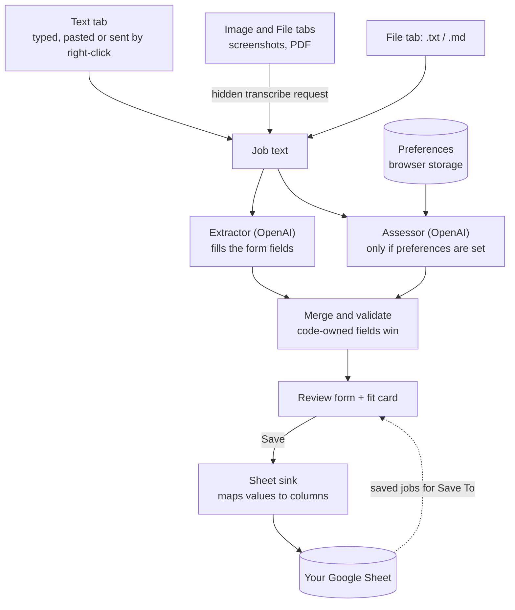

# Architecture

How Job Saver is shaped and why. Rules the code follows: [CLAUDE.md](CLAUDE.md). This file
records structure and decisions; the details live in the code.

## At a glance

A Manifest V3 Chrome extension that lives in the **side panel**. You give it a job posting as text,
images or a file; it asks OpenAI to fill a form, lets you review it, and writes a row to **your own
Google Sheet**. Optionally it also checks the job against your preferences.

- **No backend.** Everything runs in the extension. The only network calls go to OpenAI and Google.
- **The extension never reads web pages.** The posting reaches it because you hand it over: type or
  paste it, send a highlighted selection from the right-click menu, or add screenshots or a file.
- **AI proposes, you decide.** Every value is visible and editable before it is saved.
- **Stack:** TypeScript (strict), WXT, React, Chakra UI, react-hook-form + zod, TanStack Query,
  the OpenAI SDK (Structured Outputs), the Google Sheets API, Vitest.

## Data flow

1. **Give it the posting.** Three tabs, one per kind of input, each keeping what you put in it while
   you look at another. Only the tab you are on is analyzed. Text is kept in the browser session so it
   survives closing the panel; images and the file live in memory only. Text sent from the right-click
   menu lands in the Text tab.
2. **Get to plain text.** Text goes straight through. A PDF or screenshots are first read into text
   by one vision request, so everything after this step handles text only. Text files are read locally.
3. **Two requests, in parallel, same text.** The extractor fills the tracked fields. The assessor
   (when you have set preferences) returns a yes / no for each one; what the posting does not say
   counts as no. A failed assessment never loses the extracted form. The panel shows a checklist of
   these stages while they run.
4. **Merge.** Code supplies what it owns (a fresh job ID) and the model cannot override it. The result
   is validated and loaded into the form, with empty fields the AI found nothing for flagged.
5. **Review and save.** Drafts survive closing the panel. Save writes by job ID: it updates the row
   that has that ID, or fills the next empty formatted row. **Save To** retargets the draft at an
   existing job picked from a searchable list, so the form overwrites that row.

## What makes it more than a form

- **Fields are data.** One list defines every tracked field: its sheet column, its owner (the AI,
  the user, code or the assessment), its type and how it is laid out. The form, the validation
  schemas, the model's output schema and the sheet mapping are all derived from it, so adding a
  field is a one-place change. A field with no sheet column, such as the preference fit, lives only
  in the extension and is never written to the sheet.
- **The posting is untrusted.** Job text comes from arbitrary sources, including what an image or PDF
  contains, so it goes only in the user message, fenced and escaped, and the prompts tell the model
  to ignore instructions inside it. A posting cannot talk up its own fit.
- **The model suggests, code decides.** Preferences are answered by number and code writes the sheet
  text; anything code can know is never left to the model. Unknown means `null`, not a guess. The
  source of a job and its link are the user's to fill in; the model never sets them.
- **A spreadsheet is the database.** Columns are matched by header name, so you can reorder the
  sheet or add your own columns, such as a status you maintain yourself. Rows are identified by an
  internal job ID kept in the sheet. Updates write only the columns the app owns, new jobs go into
  the first empty formatted row so dropdowns survive, and sheet text is guarded against formula
  injection.
- **No access to web pages.** The extension asks for no host permissions beyond OpenAI and Google;
  the right-click menu hands it the highlighted text without any. There is no per-site setup and no
  per-site code to maintain.
- **Replaceable edges.** OpenAI and Sheets sit behind small interfaces, so the logic is pure and
  tested without network or `chrome`.

## Code map

| Folder                       | Responsibility                                                                                 |
| ---------------------------- | ---------------------------------------------------------------------------------------------- |
| `src/entrypoints`            | The side panel app (the one place features are wired together) and the background worker.      |
| `src/config`                 | Declarative knowledge: the field list and tunables such as limits.                             |
| `src/core`                   | Pure types, schemas, row mapping, prompt fencing, errors. No `chrome`, `fetch` or `openai`.    |
| `src/features`               | Vertical slices, each owning its components, hooks and adapters; they never import each other. |
| `src/features/job-input`     | The three input tabs, reading files, and turning the active tab into something to analyze.     |
| `src/features/ai-transcribe` | Reads images and PDFs into text.                                                               |
| `src/features/ai-extract`    | The extractor: prompt, OpenAI call, merge with code-owned values.                              |
| `src/features/ai-assess`     | The assessor and the fit card.                                                                 |
| `src/features/job-form`      | The review form, validation, draft persistence and the Save To picker.                         |
| `src/features/sheet-sync`    | Google sign-in, the Sheets client and the sink.                                                |
| `src/features/settings`      | API key, sheet and preferences; first-run setup.                                               |
| `src/lib`                    | Thin wrappers around the browser, storage and OpenAI, plus small utilities.                    |
| `src/theme`                  | Chakra configuration, dark mode and toasts.                                                    |
| `tests`                      | A check that keeps the README's sheet headers in sync with the field list.                     |

## Security and privacy

- Job text, images, files and your preferences go only to OpenAI, with `store: false`. Rows go only to
  Google Sheets.
- Permissions are minimal: browser storage, Google sign-in, the context menu and the side panel, plus
  network access to OpenAI and Google. No access to the pages you browse.
- The API key and the preferences live in browser storage and never in the sheet, the logs or error messages.
- The key is used directly from the browser. That is acceptable only because this is a personal,
  unpublished build; never ship a build that contains a key.

## Testing

Pure logic and adapters are unit-tested with Vitest, with `fetch` and OpenAI mocked, using made-up
data. There is no end-to-end browser automation: the UI is checked by hand in Chrome, including the
parts the test DOM cannot render, such as the dropdowns and the tags input.
