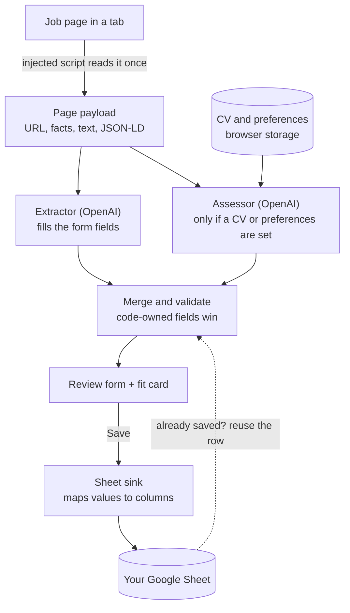

# Architecture

How Job Saver is shaped and why. Rules the code follows: [CLAUDE.md](CLAUDE.md). This file
records structure and decisions; the details live in the code.

## At a glance

A Manifest V3 Chrome extension that lives in the **side panel**. It reads the job page you are
looking at, asks OpenAI to fill a form, lets you review it, and writes a row to **your own Google
Sheet**. Optionally it also judges the job against your CV and preferences.

- **No backend.** Everything runs in the extension. The only network calls go to OpenAI and Google.
- **AI proposes, you decide.** Every value is visible and editable before it is saved.
- **Stack:** TypeScript (strict), WXT, React, Chakra UI, react-hook-form + zod, TanStack Query,
  the OpenAI SDK (Structured Outputs), the Google Sheets API, Vitest.

## Data flow

1. **Read once.** A small script injected into the tab returns one payload: URL, title, labelled
   facts read via per-site selectors, the cleaned ad text and any JSON-LD. A text selection you
   made takes precedence; unknown sites fall back to generic page text.
2. **Two requests, in parallel, same payload.** The extractor fills the tracked fields. The
   assessor (when you have set a CV or preferences) returns a CV fit as short yes / no bullets, a
   yes / no for each preference (what the posting does not say counts as no), and a verdict. A
   failed assessment never loses the extracted form.
3. **Merge.** Code derives what it can (platform, clean URL, defaults) and the model cannot override
   it. The result is validated and loaded into the form, with missing fields flagged.
4. **Review and save.** Drafts survive closing the panel. Save maps values to columns by header
   name, finds the row by job URL, then updates it or fills the next empty formatted row.

## What makes it more than a form

- **Fields are data.** One list defines every tracked field. The form, the validation schemas, the
  model's output schema and the sheet mapping are all derived from it, so adding a field is a
  one-place change.
- **The page is untrusted.** Job postings are arbitrary web content, so they go only in the user
  message, fenced and escaped, and the prompts tell the model to ignore instructions inside them. A
  posting cannot talk up its own verdict.
- **The model suggests, code decides.** Preferences are answered by number and code writes the sheet
  text; the verdict is an enum from the field config; anything code can know is never left to the
  model. Unknown means `null`, not a guess.
- **A spreadsheet is the database.** Columns are matched by header name, so you can reorder the
  sheet or add your own columns, such as a status you maintain yourself. Rows are identified by job
  URL, which gives edit mode. Updates write only the columns the app owns, new jobs go into the first
  empty formatted row so dropdowns survive, and sheet text is guarded against formula injection.
- **Permissions that fit a side panel.** The panel outlives tab switches but `activeTab` does not,
  so supported sites get static host access. Any other site is allowed one at a time through an
  "Allow on this site" button (optional host permissions).
- **Replaceable edges.** OpenAI and Sheets sit behind small interfaces, so the logic is pure and
  tested without network or `chrome`.

## Code map

| Folder                      | Responsibility                                                                                               |
| --------------------------- | ------------------------------------------------------------------------------------------------------------ |
| `src/entrypoints`           | The side panel app (the one place features are wired together), the background worker, two injected scripts. |
| `src/config`                | Declarative knowledge: the field list, per-site platforms (hosts, URL cleaning, selectors), tunables.        |
| `src/core`                  | Pure types, schemas, row mapping, prompt fencing, errors. No `chrome`, `fetch` or `openai`.                  |
| `src/features`              | Vertical slices, each owning its components, hooks and adapters; they never import each other.               |
| `src/features/page-extract` | Turns a page into the payload.                                                                               |
| `src/features/ai-extract`   | The extractor: prompt, OpenAI call, merge with code-owned values.                                            |
| `src/features/ai-assess`    | The assessor and the fit card.                                                                               |
| `src/features/job-form`     | The review form, validation and draft persistence.                                                           |
| `src/features/sheet-sync`   | Google sign-in, the Sheets client and the sink.                                                              |
| `src/features/settings`     | API key, sheet, CV and preferences; first-run setup.                                                         |
| `src/lib`                   | Thin wrappers around the browser, storage and OpenAI, plus small utilities.                                  |
| `src/theme`                 | Chakra configuration, dark mode and toasts.                                                                  |
| `tests`                     | Fixtures (saved pages), helpers, and a check that keeps the README's sheet headers in sync.                  |

## Security and privacy

- Page text and your CV go only to OpenAI, with `store: false`. Rows go only to Google Sheets.
- The API key and the CV live in browser storage and never in the sheet, the logs or error messages.
- The key is used directly from the browser. That is acceptable only because this is a personal,
  unpublished build; never ship a build that contains a key.

## Testing

Pure logic and adapters are unit-tested with Vitest, with `fetch` and OpenAI mocked. Page extraction
runs against saved real pages loaded with scripts disabled, so selector drift is caught; refresh the
fixtures if a live site changes. There is no end-to-end browser automation.
